# Design

This document explains how the catalog consolidation system works: the problem and the decisions
taken, the database, the legacy load, imports, merges, undo, conflicts, the commands and the user
interface. [README.md](README.md) covers building and running it; [PLAN.md](PLAN.md) holds the
reviewed plan and its revision history.

## 1. Context and decisions

A traditional e-commerce company becomes a marketplace. Sellers send catalog files; the same item
is often sold by several sellers, each describing it slightly differently. Products must not be
duplicated, but every seller offering a product must be recorded.

The inputs shaped several decisions:

| Observation (data profiling) | Decision |
|---|---|
| Legacy `catalog.db`: 975 products, 0 seller links; 119 without brand, 34 without category; 4 brands that differ only by case or punctuation (`Black+Decker` / `BLACK+DECKER`, `Amazon Basics` / `AmazonBasics`, ...) | One normalization key decides identity (§2.2); those 4 pairs are merged during the legacy load and recorded as merges |
| `ProductEntry.json`: every record carries its own `SellerName`; 20 sellers in one file | Imports take the seller from each record; one file may contain many sellers; there is no seller parameter |
| Seller ids repeat across sellers for unrelated products | A seller's id is unique *per seller*: `UNIQUE(seller_id, seller_product_id)` |
| 3 malformed ids, 205 ids with a non-RFC variant nibble, a SQL-injection probe | Configurable UUID policy (§4.2) and a validation layer that logs and skips bad records (§4.1) |
| The existing catalog belongs to the marketplace itself | A house seller (id 1, `HOUSE_SELLER_NAME`, default `VTEX`) offers all legacy products |

Other decisions:

- **PostgreSQL 18** at runtime; SQLite is only the source of a one-time load (§3). Trade-offs in §9.
- **One `name` column per table.** The normalized key is computed by a single immutable SQL
  function and enforced by unique expression indexes — no stored key column that could drift.
- **Rows are never deleted.** Undo and merge deactivate rows (`active = false`), so references
  stay valid and every change can be reversed.
- **Every write is logged** in `change_log`, which powers undo, undo of an undo, and unmerge with
  one mechanism (§6).
- **Read-only API and UI.** All changes go through the CLI.

## 2. Database

### 2.1 Tables

All tables live in the `catalog` schema, use snake_case, and have `created` / `updated`
(`timestamptz`; `updated` is maintained by a trigger on every table).

```mermaid
erDiagram
    seller ||--o{ seller_product : offers
    product ||--o{ seller_product : "offered as"
    product ||--o{ product_category : "classified in"
    category ||--o{ product_category : contains
    brand |o--o{ product : makes
    product |o--o{ product : "merged into"
    brand |o--o{ brand : "merged into"
    category |o--o{ category : "merged into"
    operation ||--o| import_batch : "import details"
    operation ||--o{ merge_detail : "merge details"
    operation ||--o| undo_detail : "undo details"
    operation ||--o{ change_log : "made"
    operation |o--o{ change_log : "reverted"
    change_log |o--o| change_log : "reverts"
    seller |o--o{ change_log : "attributed to"
    operation |o--o{ seller_product : "last written by"

    seller {
        bigint id PK "1 = house seller"
        text name "UNIQUE name_key(name)"
        boolean active
        timestamptz created
        timestamptz updated
    }
    brand {
        bigint id PK
        text name "UNIQUE name_key(name)"
        boolean active
        bigint merged_into_id FK
        timestamptz created
        timestamptz updated
    }
    category {
        bigint id PK
        text name "UNIQUE name_key(name), lowercase"
        boolean active
        bigint merged_into_id FK
        timestamptz created
        timestamptz updated
    }
    product {
        bigint id PK "legacy ids preserved"
        uuid uuid "UNIQUE, uuidv7(), CHECK version 7"
        text name
        bigint brand_id FK "nullable"
        boolean active
        bigint merged_into_id FK
        timestamptz created
        timestamptz updated
    }
    product_category {
        bigint product_id PK,FK
        bigint category_id PK,FK
        boolean active
        timestamptz created
        timestamptz updated
    }
    seller_product {
        bigint id PK
        bigint seller_id FK
        bigint product_id FK
        uuid seller_product_id "the seller's id"
        text name "as sent by the seller"
        text brand_name "as sent"
        text category_name "as sent"
        boolean active
        bigint last_operation_id FK
        timestamptz created
        timestamptz updated
    }
    operation {
        bigint id PK
        text kind "legacy_load, import, merge, undo"
        text status "running, completed, failed, undone, partially_undone, reverted, partially_reverted"
        timestamptz started_at
        timestamptz finished_at
        text error_message
        jsonb summary
        timestamptz created
        timestamptz updated
    }
    import_batch {
        bigint operation_id PK,FK
        text file_name "informational"
        text file_path "informational"
        char md5 "file identity, CHECK hex"
        bigint file_size
        text id_validation "policy used"
        int total_records
        int invalid_records
        int skipped_records
        int sellers_created
        int products_created
        int products_updated
        int duplicate_products
        int offers_created
        int offers_updated
        int unchanged
        timestamptz created
        timestamptz updated
    }
    merge_detail {
        bigint id PK
        bigint operation_id FK
        text entity_type "product, brand, category"
        bigint kept_id
        bigint merged_id "manual merges"
        text merged_name "legacy-load spellings"
        text origin "legacy_load, manual"
        timestamptz created
        timestamptz updated
    }
    undo_detail {
        bigint operation_id PK,FK
        text undo_kind "import_undo, merge_undo, revert"
        jsonb criteria
        int changes_reverted
        int conflicts_skipped
        timestamptz created
        timestamptz updated
    }
    change_log {
        bigint id PK
        bigint operation_id FK
        bigint seller_id FK
        text table_name
        jsonb row_pk
        text action "insert, update"
        jsonb old_values
        jsonb new_values
        bigint reverts_change_id FK
        bigint reverted_by_operation_id FK
        timestamptz created
        timestamptz updated
    }
```



| Table | Purpose |
|---|---|
| `seller` | Sellers, identified everywhere by id; looked up by name through the key function, so a rename touches one row. Seller 1 is the house seller. |
| `brand`, `category` | One row per normalized name. Brands keep the first spelling seen; category names are stored lowercase. |
| `product` | The consolidated catalog. `uuid` is a public UUIDv7 generated by PostgreSQL. |
| `product_category` | Many-to-many: a product can be in several categories (an iPhone in *mobile phones* and *electronics*). |
| `seller_product` | A seller's offer: the link seller ↔ product, the seller's own id, and the seller's raw name/brand/category (the "slight variations"). |
| `operation` | Every write command: legacy load, import, merge, undo. Status and a JSON summary. |
| `import_batch` | Per import: file name, **MD5**, size, UUID policy used and the counters required by the specification. |
| `merge_detail` | What was merged into what (manual merges, and the spellings merged by the legacy load). |
| `undo_detail` | What an undo targeted (criteria), how many changes it reverted, conflicts skipped. |
| `change_log` | Every insert/update of a catalog row, with old and new values — the basis of undo. |

### 2.2 One normalization algorithm, in the database

```sql
catalog.name_key(t) = regexp_replace(lower(unaccent(normalize(t, NFKC))), '[^a-z0-9]', '', 'g')
```

`Câmera Canon EOS-R6` → `cameracanoneosr6`, `Amazon Basics` and `AmazonBasics` → `amazonbasics`,
`BLACK+DECKER` and `Black & Decker` → `blackdecker`, `Levi's` → `levis`, `Straße` → `strasse`,
full-width `ＡＢＣ１２３` → `abc123`. It is declared `IMMUTABLE` (the unaccent dictionary is
pinned) so it can back indexes; if the unaccent rules file is ever changed, `REINDEX` the key
indexes.

Why no `name_key` column: a stored key computed by the application can disagree with the name it
was derived from. Here the key exists only as an index expression, and every lookup uses the same
function (`WHERE catalog.name_key(name) = catalog.name_key(:input)`), so the uniqueness rule, the
importer, the legacy load and the API filters cannot diverge.

A second function, `catalog.name_fold(t)`, keeps word boundaries (`hugo boss`) and is used only for
"looks similar" suggestions (pg_trgm), never for identity.

### 2.3 Constraints and indexes

| Rule | Enforcement |
|---|---|
| Apple = apple = APPLE (brands, categories, sellers) | `UNIQUE INDEX (catalog.name_key(name))` |
| Names must contain latin letters or digits | `CHECK (catalog.name_key(name) <> '')` |
| Categories all use the same case | `CHECK (name = lower(name))` |
| No two products with the same name + brand | `UNIQUE INDEX (catalog.name_key(name), brand_id) NULLS NOT DISTINCT` (category is many-to-many, so it is not part of identity) |
| A seller offers a product once; a seller id identifies one offer | `UNIQUE (seller_id, product_id)`, `UNIQUE (seller_id, seller_product_id)` |
| Product UUIDs are version 7 | `DEFAULT uuidv7()` and `CHECK (uuid_extract_version(uuid) IS NOT DISTINCT FROM 7)` — the NULL-safe comparison matters: `uuid_extract_version()` returns NULL for non-RFC variants and a CHECK that evaluates to NULL passes |
| An import's MD5 is a real digest | `CHECK (md5 ~ '^[0-9a-f]{32}$')` |
| Nothing is deleted | every foreign key is `ON DELETE RESTRICT` |

Performance indexes: partial indexes on active rows for brand filters, category membership and
"who sells this product"; GIN trigram indexes on `name_fold(name)`; change-log indexes by
operation, by seller and time, and by row.

### 2.4 Roles

Created by `docker/postgres/initdb/01-roles.sh` when the database volume is initialized:

- `catalog_owner` owns the schema; used by migrations and the CLI.
- `catalog_reader` has `SELECT` only and `default_transaction_read_only = on`; the API connects as
  this role, so it cannot write even if it had a bug.

The cluster uses PostgreSQL's builtin `C.UTF-8` locale provider, so case mapping is identical on
every platform.

## 3. From SQLite to PostgreSQL: `make psqlmigrate`

Alembic migrations run on PostgreSQL only:

| Revision | Content |
|---|---|
| `0001_schema` | extensions (`unaccent`, `pg_trgm`), key functions, tables, constraints, indexes, triggers, grants |
| `0002_initial_data` | house seller; with a legacy SQLite path, the one-time legacy load. Without a path it refuses ("run make psqlmigrate") unless `ALLOW_EMPTY_CATALOG=1`. Irreversible. |

`make psqlmigrate` uses `compose.legacy-migration.yaml`: it starts PostgreSQL (same project and
volume as the standard stack), mounts the SQLite file **read-only**, and runs
`catalog db upgrade --legacy-sqlite /legacy/catalog.db`. The load:

1. opens the SQLite file read-only and checks the expected tables and columns;
2. validates every row with the same rules as imports — any failure aborts and lists the rows;
3. copies the rows into a temporary staging table, then transforms them with set-based SQL that
   uses `catalog.name_key` (brands: most used spelling wins, the other spellings are recorded in
   `merge_detail` with `origin = legacy_load`; categories lowercased);
4. inserts products **with their legacy ids** (UUIDv7 generated in id order), category links, and
   one house-seller offer per product (`seller_product_id` = the product uuid);
5. moves the id sequences past the loaded ids;
6. verifies the counts against the source and stores the report in `operation.summary`.

Everything runs in one transaction: a failure leaves an empty database. Running it again prints
"already migrated". A database initialized empty (`ALLOW_EMPTY_CATALOG`) is refused, because the
load needs an empty catalog. The standard `compose.yaml` has no SQLite at all; its `migrate`
service applies future migrations and refuses to initialize a database that was never loaded.

## 4. Import

`catalog import run FILE` (`make import FILE=...`). The file is a JSON array of records
`{Id, SellerName, Name, Brand, Category}`.

1. The file is hashed (MD5, streamed). An `operation` + `import_batch` row is committed **before**
   processing, so failed attempts are recorded too.
2. The catalog write lock is taken (§7.4).
3. If another import of the same MD5 is currently effective, the import is refused (`--force`
   imports it anyway). Undone imports do not block.
4. Records are validated (§4.1); invalid ones are logged and counted, never imported.
5. Each valid record, in one transaction:
   - **seller**: found by key or created (`--no-create-sellers` rejects unknown sellers);
   - **brand / category**: found by key (following `merged_into_id`, reactivating inactive rows)
     or created;
   - **product** matching: same key + same brand; else the same key with no brand (the product is
     enriched with the brand); a record without a brand matches the single product with that key,
     and is skipped as `AMBIGUOUS_MATCH` when several branded products share it; else a new product;
   - **category link** added if missing (a product gains categories over time);
   - **offer** upserted by (seller, seller id): new, updated (raw fields changed, re-pointed or
     reactivated) or unchanged.
6. The counters are stored and the operation completes; any unexpected error rolls back every data
   change and marks the import `failed` with the error.

Counters (`import_batch`): `total_records`, `invalid_records`, `skipped_records`,
`sellers_created`, `products_created`, `duplicate_products` (record matched an existing product —
not inserted, linked), `products_updated` (an existing product was enriched: brand filled,
category added, reactivated), `offers_created`, `offers_updated`, `unchanged`. A per-seller
breakdown and the list of rejected records are kept in `operation.summary`.

`--dry-run` processes everything and rolls back.

### 4.1 Validation (`catalog.validation`)

Every rejection is logged (standard `logging`, logger `catalog.import`, WARNING) with the record
index, seller and rule; values are logged with `repr()` and truncated, so they cannot forge log
lines.

| Code | Rule |
|---|---|
| `BAD_TYPE`, `MISSING_FIELD`, `TOO_LONG` | structure (Pydantic): `Id`, `SellerName`, `Name` required; strings or null; Name ≤ 300, others ≤ 120 |
| `CONTROL_CHARS` | NUL, C0/C1 controls, bidi overrides, zero-width characters |
| `MARKUP` | HTML/JS: the value changes when sanitized by **nh3** (also entity-encoded markup), `javascript:`/`vbscript:`/`data:` URIs, `on…=` handlers |
| `SQL_INJECTION` | statement separators followed by SQL keywords, `--`, `/* */`, tautologies, `UNION SELECT`, `sleep(`/`benchmark(`/`waitfor delay` (checked after NFKC, so full-width tricks are caught) |
| `INVALID_ID_*` | the UUID policy (§4.2) |
| `EMPTY_KEY` | no latin letters or digits — checked with the database key function, so it matches the database CHECK exactly |

The rules are conservative: `Levi's`, `34"`, `BLACK+DECKER`, `Select Comfort`, `C++ Primer` pass.
They are a policy layer; the actual protections are bound parameters everywhere, a JSON-only API
and an escaping, script-free UI.

Records skipped while processing (not invalid, but not importable) are `UNKNOWN_SELLER`,
`AMBIGUOUS_MATCH` and `DUPLICATE_OFFER` (§7.1).

### 4.2 UUID policy

Our own product ids are **UUIDv7** (PostgreSQL `uuidv7()`): time-ordered, so inserts append to
the unique index, and sortable by creation. A v7 id reveals its creation time, which is acceptable
for public catalog ids.

Seller ids are stored in a `uuid` column; how strictly they are validated is configurable:

| Check | `lenient` (default) | `strict` | Code |
|---|---|---|---|
| canonical `8-4-4-4-12` hex (stored lowercase) | ✔ | ✔ | `INVALID_ID_FORMAT` |
| version in `ID_ALLOWED_VERSIONS` (default `4,7`) | ✔ | ✔ | `INVALID_ID_VERSION` |
| RFC 9562 variant bits | — | ✔ | `INVALID_ID_VARIANT` |
| v7 timestamp between `ID_V7_MIN_DATE` and now + `ID_V7_MAX_SKEW` | — | ✔ | `INVALID_ID_V7_TIMESTAMP` |

The Nil and Max UUIDs carry version nibbles 0 and 15, never allowed, so both modes reject them.
On the sample file `lenient` accepts 266 records and `strict` 61 (205 ids have a non-RFC variant).
Accepting only genuine UUIDv7 later is a configuration change:
`ID_VALIDATION_MODE=strict ID_ALLOWED_VERSIONS=7`. Each import records the policy it used, and
`import run --id-validation/--id-versions` override it per run.

## 5. Merge and unmerge

Exact duplicates cannot exist (unique key indexes). Near-duplicates (`Processor` vs `Processador
AMD Ryzen 9 7950X`, `Hugo` vs `Hugo Boss`) are suggested by `catalog duplicates list`, which
scores pairs with `pg_trgm` similarity and word similarity on `name_fold(name)` (products are only
compared within the same brand) and prints the merge command to run. A human decides.

| Command | Effect |
|---|---|
| `merge product --keep K --duplicate D …` | `D` becomes inactive with `merged_into_id = K`; its offers move to `K` (if the seller already offers `K`, `D`'s offer is deactivated instead); its categories are added to `K`; `K` takes `D`'s brand if it had none |
| `merge brand --keep K --duplicate D [--merge-products]` | `D`'s products move to brand `K`; if that would create two products with the same name and brand, the command aborts listing the pairs, or merges them with `--merge-products` |
| `merge category --keep K --duplicate D` | `D`'s product links move to `K` (existing links are kept); `D` becomes inactive |

Imports after a merge follow `merged_into_id`, so a seller still sending the old name lands on the
kept product.

**Unmerge** (`catalog merge undo ID`) reverses a manual merge with the undo engine (§6),
all-or-nothing: the duplicate is reactivated, moved offers and products go back, added category
links are deactivated, a filled brand is cleared. It does **not** move rows created after the
merge (e.g. an offer a later import attached to the kept product) — these are listed in the
output. Merges recorded by the legacy load cannot be undone: their spellings share one key, so
restoring both would violate the unique index by design. An unmerge can itself be reverted
(`catalog undo revert`), which re-applies the merge.

## 6. Undo

### 6.1 Mechanism

Every catalog write records a `change_log` row (`old_values`, `new_values`). Undoing a set of
changes is itself an operation of kind `undo`:

1. select the target changes that are still effective (`reverted_by_operation_id IS NULL`);
2. for each change, newest first, **check that the row still holds the values the change wrote**
   (otherwise it is a conflict, §7.3);
3. reverse it: an update gets its old values back; an insert is reversed by deactivating the row
   (unless something active still references it — e.g. a product another seller still offers, a
   brand still used — in which case it stays active and the report says why; the house seller is
   never deactivated);
4. record a compensating change (`reverts_change_id` → the reversed change) and mark the reversed
   change with `reverted_by_operation_id`;
5. recompute statuses: an import becomes `undone` or `partially_undone`; an undo becomes
   `reverted` or `partially_reverted`.

**Undo of an undo** (`catalog undo revert ID`) is the same engine aimed at the undo's own changes.
Reversing a compensating change makes the original change effective again (and so on down the
chain: effectiveness alternates along `reverts_change_id`). A revert is also an undo, so it can be
reverted, to any depth:

```
import 2 (completed)
  └─ undo 5 reverts import 2      -> import 2: undone,     undo 5: completed
       └─ revert 6 reverts undo 5 -> import 2: completed,  undo 5: reverted
            └─ revert 7 reverts 6 -> import 2: undone,     undo 5: completed, revert 6: reverted
```

The tests compare full table snapshots at each step of such chains.

### 6.2 Import undo

```
catalog import undo --md5 HASH [--md5 HASH …] [--seller NAME] [--since …] [--until …] [--dry-run] [--skip-conflicts] [--yes]
catalog import undo --all-files --since …      [--seller NAME] [--until …] [--dry-run] [--skip-conflicts] [--yes]
```

- Files are identified **only by their MD5** — a full 32-hex digest; names and paths are never
  used (files get renamed; different files share names). `catalog import hash FILE`,
  `import list` and the UI show the hashes.
- Without `--seller`, every seller's changes in the file are undone; with `--seller`, only that
  seller's part (each change is attributed to the seller of the record that caused it).
- `--all-files --since 2d` undoes every import in the window (`--since` is mandatory).
- The command shows the files, dates and effects, then asks for confirmation (`--yes` skips it;
  `--dry-run` changes nothing).
- The legacy load cannot be undone.

After an undo, the same file can be imported again: undone imports do not trigger the MD5 guard,
and matching rows are **reactivated** rather than duplicated.

## 7. Conflicts

### 7.1 Import

| Situation | Behaviour |
|---|---|
| Another write operation is running | waits for the lock; `--no-wait` fails with exit code 3 |
| Same MD5 already effective | refused (recorded as a failed import); `--force` imports it again |
| The seller already offers the matched product under another id | record skipped: `DUPLICATE_OFFER` (one offer per product per seller) |
| A seller id now describes a different product | the offer is re-pointed (`offers_updated`) |
| No brand, and several products with different brands share the name | record skipped: `AMBIGUOUS_MATCH` |
| Unknown seller with `--no-create-sellers` | record skipped: `UNKNOWN_SELLER` |
| Matched row was merged / is inactive | follows `merged_into_id` / reactivates the row |
| Unexpected database error | everything rolls back; the import is recorded as `failed` |

In the sample file, 11 records are `DUPLICATE_OFFER`: the same seller sending the same product
twice under different ids (e.g. `Basketball Spalding Official` and `Basketball Spalding  Official`).

### 7.2 Merge

| Situation | Behaviour |
|---|---|
| keep = duplicate, unknown ids, inactive or already merged rows | refused, nothing changes |
| One seller offers both products | that seller's duplicate offer is deactivated (restored by unmerge) |
| Brand merge would create duplicate products | aborted with the list (exit 4), or merged with `--merge-products` |
| Category link already exists | skipped |
| Unmerge after later operations changed rows the merge wrote | aborted, all-or-nothing (exit 4) |

### 7.3 Undo and revert

A change can be reversed only if the row still holds exactly the values that change wrote, in the
columns it wrote. Anything else means a later operation (or a manual edit, such as a seller rename)
modified the row. This value-based rule works through any undo/revert chain without needing to know
the order of operations.

- Import undo: aborts on the first conflict by default (exit 4), naming the row, the expected and
  current values and the last operation that changed it. `--skip-conflicts` undoes everything else
  and records what was skipped.
- Revert and merge undo: always all-or-nothing.

### 7.4 Concurrency

Every write command takes the same transaction-scoped advisory lock, so imports, merges and undos
never interleave. Reads (API, UI) are never blocked (MVCC).

## 8. Commands

`catalog --help` lists everything; global options: `--database-url`, `--log-level`, `--log-file`.

| Command | Purpose |
|---|---|
| `db upgrade [REV] [--legacy-sqlite PATH] [--allow-empty]`, `db downgrade REV`, `db current`, `db history` | migrations |
| `seller list [--show-inactive]`, `seller rename OLD NEW` | sellers (any spelling of the name works) |
| `import run FILE [--dry-run] [--force] [--no-create-sellers] [--id-validation] [--id-versions] [--no-wait]` | import a file |
| `import hash FILE`, `import list [--seller] [--since] [--until] [--md5] [--format table\|md5]`, `import show ID\|--md5 HASH` | find imports and their hashes |
| `import undo …` | §6.2 |
| `undo list`, `undo show ID`, `undo revert ID` | undo history; undo of an undo |
| `duplicates list --entity product\|brand\|category [--threshold] [--format table\|json]` | merge suggestions |
| `merge product\|brand\|category …`, `merge list`, `merge undo ID` | merges and unmerges |
| `serve [--host] [--port]` | run the API |

Exit codes: `0` ok, `1` error, `2` usage error, `3` write lock busy (`--no-wait`), `4` conflicts.

The `make` targets wrapping these for the Docker stack (`make import`, `make undo`, `make cli`,
…) are listed by `make help`.

### REST API

`GET` only, under `/api/v1` (OpenAPI docs at `/api/v1/docs`). Lists take `limit` (default 100,
1–1000) and `offset` and return `{items, total, limit, offset}` ordered by id. `show_inactive=true`
includes deactivated and merged rows (otherwise they are hidden and their detail is 404). Name
parameters accept any spelling (they go through `catalog.name_key`).

| Endpoint | Content |
|---|---|
| `/health`, `/stats` | health (database, schema at head, legacy load done); catalog counts and the latest import |
| `/brands`, `/brands/{id}`, `/brands/{id}/sellers` | brands with product counts; sellers of a brand |
| `/categories`, `/categories/{id}`, `/categories/{id}/sellers` | same for categories |
| `/sellers`, `/sellers/{name}`, `/sellers/{name}/products` | sellers with offer counts; a seller's catalog with raw fields |
| `/products?brand=&category=&seller=&brand_id=&category_id=&q=` | products with brand, categories and sellers embedded |
| `/products/{id}`, `/products/uuid/{uuid}` | product with every seller's offer |
| `/imports?md5=&seller=&since=&until=&status=`, `/imports/{id}` | import history, counters, per-seller breakdown, related undos |
| `/merges`, `/undos` | audit trail |

## 9. User interface

A separate Node.js project (`ui/`): Express 5, EJS templates and Bootstrap's stylesheet. Pages are
rendered on the server from API data; **the browser runs no JavaScript**.

| Page | What you see |
|---|---|
| Home | catalog counts and the latest import |
| Products | searchable table (name, brand, category, seller filters) with brand, categories and sellers of each product |
| Product | UUID, brand, categories, and every seller's offer as the seller describes it |
| Brands → brand | the brand's products, each with the sellers selling it, and a panel with all sellers of the brand |
| Categories → category | the category's products and every seller selling products in it |
| Sellers → seller | the seller's catalog: their descriptions linked to the catalog products |
| Imports → import | history with status, file name and copyable MD5; counters, per-seller breakdown, rejected records, related undos |
| Merges, Undos | audit trail |

Every name is a link (product → brand → its sellers → a seller's catalog → …). The
"Show inactive" button includes deactivated and merged rows.

Read-only by construction: only `GET`/`HEAD` routes exist (anything else gets 405); a single
GET-only API client is the only code allowed to call `fetch` (eslint rule and test); there are no
POST forms; undo and merge commands are only *displayed* as text to copy into a terminal; the API
behind it uses the read-only database role. All values are HTML-escaped (`<%= %>`; raw output only
for template includes, enforced by a test) and the Content-Security-Policy forbids scripts
(`script-src 'none'`).

## 10. PostgreSQL trade-offs

| Gains | Costs (and mitigations) |
|---|---|
| One `name` column with database-computed keys; no drift between key and name | an extra service to run (Compose brings it up; `make db-dump`, `make db-reset`) |
| Real constraints: expression indexes, `NULLS NOT DISTINCT`, NULL-safe UUIDv7 CHECK, `jsonb`, `timestamptz` | no longer a single portable file; the exercise started from SQLite (`make psqlmigrate` makes the transition explicit, verified and repeatable; the SQLite file is never modified) |
| MVCC: the API keeps serving while imports run; explicit advisory locks for writers | tests need a database server (throwaway tmpfs PostgreSQL; DB-free unit tests for fast feedback) |
| A read-only role for the API, enforced by the server | `unaccent()` wrapped as IMMUTABLE assumes its rules file does not change (REINDEX if it does) |
| `uuidv7()` and `pg_trgm` built in (no app-side generation, no fuzzy-matching library) | snake_case identifiers instead of the legacy PascalCase (consistent across all tables; the loader maps the names) |
| `pg_dump` backups, real `ALTER TABLE`, a path to managed hosting | the Dockerfiles cannot run the database-backed tests; `make build` is the gate |

## 11. Technology stack

Python 3.14 (FastAPI, Pydantic 2, SQLAlchemy 2.1 Core, psycopg 3, Alembic, click, nh3),
PostgreSQL 18.6, Node.js 24 (Express 5, EJS 7, helmet, morgan, Bootstrap 5.3 CSS only). Tests:
pytest + pytest-cov, httpx2 (FastAPI test client), node:test + supertest + c8. Lint: ruff (PEP 8
and a few bug-finding rule sets, line length 99), mypy, ESLint, Prettier, shellcheck. Every
component was checked for maintenance and known vulnerabilities on 2026-10-12 (PLAN.md §12);
Python dependencies are installed from a hash-pinned lockfile, npm packages with `npm ci
--ignore-scripts`, base images are pinned by digest, and `make audit` runs pip-audit and npm audit.

## 12. Limitations and future work

- Matching is exact on the normalized key; near-duplicates are only suggested. Category synonyms
  (`Photo` vs `Photography`) need a merge or a future alias table.
- Names written only in non-latin scripts have an empty key and are rejected.
- Renaming a seller does not keep the old name as an alias: a file using the old name creates a
  new seller (the rename command warns).
- No variants, prices or stock; no import API; no authentication on the API.
- Partial reverts/unmerges are not supported (all-or-nothing by design).
