# Catalog Consolidation — Implementation Plan

Status: **implemented (version 1)**. The plan below is the approved rev. 10; the differences found during implementation are listed in §21. README.md and DESIGN.md describe the system as built.

<details><summary>Revision history (summary)</summary>

- **rev. 1–3:**
  - data profiling
  - sellers come from the file
  - soft deactivation
  - validation package
  - duplicate/merge commands
  - undo by MD5 only, never by file name
- **rev. 4–5:**
  - `--all-files --since`
  - read-only UI as a separate Express + EJS project
- **rev. 6:** stack review (Bootstrap CSS only, Express 5, Node 24, Python 3.14, httpx2) and supply-chain controls.
- **rev. 7–8:**
  - Makefile + scripts with quality gates
  - Docker Compose as the standard way to bring up environments
  - UUIDv7 with configurable strictness
  - no GitHub Actions
  - optional hadolint
- **rev. 9:**
  - PostgreSQL 18 with a one-time SQLite load (`make psqlmigrate`)
  - single `name` column with a DB key function
  - undo of an undo (revert) and merge undo
  - documented conflicts
  - advisory audit in `make build`
  - lighter lint, pytest
  - README/DESIGN deliverables
  - house seller `VTEX`
- **rev. 10:** final. Open questions settled with their defaults; no design changes.

</details>

---

## 0. What the data actually looks like

**`data/catalog.db` (legacy SQLite, the source of the initial load)**
- `Product` has 975 rows. 119 have no `Brand` and 34 have no `Category`.
- `SellerProduct` has **0 rows**.
- Under the normalization in §1 H, the **only** key collisions are 4 brand pairs: `Amazon Basics`/`AmazonBasics`, `Simple Houseware`/`SimpleHouseware`, `simplehuman`/`Simplehuman`, `Black+Decker`/`BLACK+DECKER`. Product names and categories have none.

**`data/ProductEntry.json`** has 269 records from 20 sellers, all with the keys `Id, SellerName, Name, Brand, Category`.
- 263 of them match an existing product on normalized name + brand; 6 are new.
- 14 `Id`s repeat:
  - one is the same seller sending the same item twice (`Câmera`/`Camera Canon EOS R6`)
  - 13 are different sellers reusing an Id for unrelated products, so a seller's Id is only unique **per seller**
- **Ids:**
  - 3 aren't canonical UUIDs (`ddddeee-…`, `uddd0000-…`, `09835342345-…`)
  - the other 266 all have version nibble `4`, but 205 of them have a non-RFC variant nibble (§4.1)
- 1 record carries an injection probe: Brand `TestBrand'; SELECT 1; --`.
- These legitimate values must **not** be rejected: `Levi's`, `Monitor LG UltraWide 34"`, `BLACK+DECKER`, `5.11`, `Park & Sun Sports`.

---

## 1. Decisions

| # | Topic | Decision |
|---|---|---|
| A | Seller identity | `seller(id, name, active, …)`. The CLI and API take seller **names** and resolve them with `catalog.name_key()`. Every FK uses `seller_id`, so `catalog seller rename OLD NEW` changes one row. |
| B | House seller | Seller **`id = 1`, named by `HOUSE_SELLER_NAME` (default `VTEX`)**. The setting lives in the top-level `.env` / `.env.example` and in `src/catalog/config.py` (`DEFAULT_HOUSE_SELLER_NAME = "VTEX"`, `HOUSE_SELLER_ID = 1`). See the details below the table. |
| C | Product UUID | `product.uuid uuid NOT NULL UNIQUE DEFAULT uuidv7()`, created by PostgreSQL 18's built-in `uuidv7()`. The CHECK enforces version 7 NULL-safely (§4.1). Legacy integer `id`s are preserved. The original requirement said UUID4; v7 was chosen during review. |
| D | `seller_product` | One table for a seller's offer: the link (`seller_id`, `product_id`), the seller's own id (`seller_product_id uuid`), the **raw** `name`/`brand_name`/`category_name` as sent, and `active`. |
| E | Naming | **snake_case**, singular table names, in a dedicated `catalog` schema. PostgreSQL folds unquoted identifiers to lower case, so the legacy PascalCase would force quoting everywhere. Field names stay consistent across all tables, as required. The legacy loader maps `Name`→`name`, and so on. |
| F | Offer uniqueness | `UNIQUE(seller_id, seller_product_id)` and `UNIQUE(seller_id, product_id)`. Inactive rows are included, so re-imports **reactivate** instead of inserting. |
| G | Product uniqueness | `UNIQUE INDEX ON product (catalog.name_key(name), brand_id) NULLS NOT DISTINCT`. Category is many-to-many (`product_category`). |
| H | Normalization: **one algorithm, in the DB** | `catalog.name_key(t)` = `regexp_replace(lower(unaccent('public.unaccent', normalize(t, NFKC))), '[^a-z0-9]', '', 'g')`, declared `IMMUTABLE`. It produces `Câmera Canon EOS-R6`→`cameracanoneosr6`, `Amazon Basics`→`amazonbasics`, `Levi's`→`levis`, `Ørsted`→`orsted`, `Straße`→`strasse`, full-width `ＡＢＣ１２３`→`abc123`. The same function is used for products, brands, categories and sellers. The prototype on PostgreSQL 18.6 returned exactly these values. |
| I | Enforcement in the DB | Each of `seller`, `brand`, `category`: `UNIQUE INDEX ON t (catalog.name_key(name))` + `CHECK (catalog.name_key(name) <> '')`. `product` gets the index in G and the same CHECK. **There is no stored key column**, so nothing can drift. The app does no key computation of its own: lookups use `WHERE catalog.name_key(name) = catalog.name_key(:input)`, which hits the index, and get-or-create uses `INSERT … ON CONFLICT (catalog.name_key(name)) DO NOTHING`. |
| J | Display case | Brand and seller keep the first spelling seen. Category `name` is stored lowercase, with `CHECK (name = lower(name))`. The cluster uses PostgreSQL's **builtin `C.UTF-8` locale provider** (`initdb --locale-provider=builtin`), so `lower()` and the key function behave the same on every platform (glibc, musl). |
| K | created/updated | Every table has `created timestamptz NOT NULL DEFAULT now()` and `updated timestamptz NOT NULL DEFAULT now()`. One shared `catalog.set_updated()` `BEFORE UPDATE` trigger function keeps `updated` current. |
| L | Soft deactivation | `active boolean NOT NULL DEFAULT true` on `seller`, `brand`, `category`, `product`, `product_category` and `seller_product`. `brand`, `category` and `product` also get `merged_into_id` (a self-FK). Undo, merge and revert never `DELETE`. |
| M | Duplicate matching on import | Exact key match on (`name_key(name)`, `brand_id`). If the incoming record has no brand, it matches a product with the same key **only if exactly one candidate exists** (a branded product is enriched only when unambiguous, §8.1). A match on a merged product follows `merged_into_id`. A match on an inactive product reactivates it. |
| N | Write serialization | Every write command (legacy load, import, merge, undo, revert) takes `pg_advisory_xact_lock(<catalog lock id>)`, so writers never interleave. API reads are unaffected (MVCC). `--no-wait` fails immediately when another write is running; the default is to wait. |

**House seller details (B):**
- The `0002` migration creates the house seller and the legacy load attaches the 975 legacy products to it.
- Its offers created by the legacy load can't be undone.
- If `HOUSE_SELLER_NAME` later differs from seller 1's stored name, the CLI warns. `catalog seller rename` applies the new name.

---

## 2. Target schema (PostgreSQL, schema `catalog`)

```mermaid
erDiagram
    seller ||--o{ seller_product : offers
    product ||--o{ seller_product : "offered as"
    product ||--o{ product_category : "classified in"
    category ||--o{ product_category : contains
    brand |o--o{ product : makes
    product |o--o{ product : "merged into"
    brand |o--o{ brand : "merged into"
    category |o--o{ category : "merged into"
    operation ||--o| import_batch : "details (import)"
    operation ||--o| merge_detail : "details (merge)"
    operation ||--o| undo_detail : "details (undo/revert/unmerge)"
    operation ||--o{ change_log : "made"
    operation |o--o{ change_log : "reverted"
    change_log |o--o| change_log : "reverts"
    seller |o--o{ change_log : "attributed to"

    seller {
        bigint id PK "1 = house seller (VTEX)"
        text name "UNIQUE name_key(name)"
        boolean active
        timestamptz created
        timestamptz updated
    }
    brand {
        bigint id PK
        text name "UNIQUE name_key(name), display spelling"
        boolean active
        bigint merged_into_id FK
        timestamptz created
        timestamptz updated
    }
    category {
        bigint id PK
        text name "UNIQUE name_key(name), CHECK lowercase"
        boolean active
        bigint merged_into_id FK
        timestamptz created
        timestamptz updated
    }
    product {
        bigint id PK "legacy ids preserved"
        uuid uuid "UNIQUE, DEFAULT uuidv7()"
        text name
        bigint brand_id FK "nullable"
        boolean active
        bigint merged_into_id FK
        timestamptz created
        timestamptz updated
    }
    product_category {
        bigint product_id PK,FK
        bigint category_id PK,FK
        boolean active
        timestamptz created
        timestamptz updated
    }
    seller_product {
        bigint id PK
        bigint seller_id FK
        bigint product_id FK
        uuid seller_product_id "seller's id"
        text name "raw"
        text brand_name "raw"
        text category_name "raw"
        boolean active
        bigint last_operation_id FK
        timestamptz created
        timestamptz updated
    }
    operation {
        bigint id PK
        text kind "legacy_load|import|merge|undo"
        text status "running|completed|failed|undone|partially_undone|reverted"
        timestamptz started_at
        timestamptz finished_at
        text error_message
        jsonb summary "report, e.g. legacy-load verification"
        timestamptz created
        timestamptz updated
    }
    import_batch {
        bigint operation_id PK,FK
        text file_name "informational only"
        text file_path "informational only"
        char md5 "CHECK ^[0-9a-f]{32}$"
        bigint file_size "bytes"
        text id_validation "e.g. lenient;versions=4,7"
        int total_records
        int invalid_records
        int sellers_created
        int products_created
        int products_updated
        int duplicate_products
        int offers_created
        int offers_updated
        int unchanged
        timestamptz created
        timestamptz updated
    }
    merge_detail {
        bigint operation_id PK,FK
        text entity_type "product|brand|category"
        bigint kept_id
        bigint merged_id
        text origin "legacy_load|manual"
        timestamptz created
        timestamptz updated
    }
    undo_detail {
        bigint operation_id PK,FK
        text undo_kind "import_undo|merge_undo|revert"
        jsonb criteria "md5 list, all_files, seller, since, until, target op ids"
        int changes_reverted
        int conflicts_skipped
        timestamptz created
        timestamptz updated
    }
    change_log {
        bigint id PK
        bigint operation_id FK "who made this change"
        bigint seller_id FK "seller the change is attributed to"
        text table_name
        jsonb row_pk
        text action "insert|update"
        jsonb old_values "columns before (update)"
        jsonb new_values "columns written"
        bigint reverts_change_id FK "set on changes made by an undo"
        bigint reverted_by_operation_id FK "set while this change is undone"
        timestamptz created
        timestamptz updated
    }
```



**Why `operation` and the detail tables:**
- Imports, merges, undos and reverts are all *operations* that write `change_log` rows.
- The undo engine (§6) works the same way for all of them. That makes "undo an undo" and "undo a merge" fall out of one mechanism instead of three special cases.
- `import_batch` keeps every field the requirement asks for: timestamp (`operation.started_at`), file name, MD5, size and counters.

**Indexes and constraints**

| Table | Index / constraint | Serves |
|---|---|---|
| seller, brand, category | `UNIQUE (catalog.name_key(name))`, `CHECK (catalog.name_key(name) <> '')` | lookup by any spelling, dedup (Apple = apple, Amazon Basics = AmazonBasics) |
| brand, category, product | `GIN (catalog.name_fold(name) gin_trgm_ops)` | near-duplicate search (§7.1) |
| category | `CHECK (name = lower(name))` | same-case rule |
| product | `UNIQUE (catalog.name_key(name), brand_id) NULLS NOT DISTINCT`, `UNIQUE (uuid)`, `CHECK (uuid_extract_version(uuid) IS NOT DISTINCT FROM 7)`, `INDEX (brand_id) WHERE active`, `INDEX (id) WHERE active` | dedup; uuid lookup; brand filter; default listing |
| product_category | `PK (product_id, category_id)`, `INDEX (category_id, product_id) WHERE active` | many-to-many in both directions |
| seller_product | `UNIQUE (seller_id, seller_product_id)`, `UNIQUE (seller_id, product_id)`, `INDEX (product_id, seller_id) WHERE active` | offer rules; who sells X; brand/category → sellers |
| import_batch | `INDEX (md5)`, `CHECK (md5 ~ '^[0-9a-f]{32}$')` | undo by hash; same-file detection |
| operation | `INDEX (kind, started_at)` | history, `--since` windows |
| change_log | `INDEX (operation_id)`, `INDEX (seller_id, created)`, `INDEX (table_name, row_pk)`, `INDEX (reverted_by_operation_id)` | undo selection, conflict reporting |

- Foreign keys are `ON DELETE RESTRICT`, since nothing is ever deleted.
- `catalog.name_fold(t)` is a second immutable function: NFKC + unaccent + lower, with punctuation turned into spaces and whitespace collapsed. It keeps word boundaries so trigram similarity works well. **It is never used for uniqueness**, only for "looks similar" suggestions.

**Roles.** These are created by the PostgreSQL container's init script, with passwords from `.env`:
- `catalog_owner` owns the schema. The `migrate` and `cli` services use it.
- `catalog_reader` has `SELECT` only and `default_transaction_read_only = on`. **The API connects as this role**, which is a stronger read-only guarantee than SQLite's `mode=ro`.

---

## 3. Migrations (Alembic, PostgreSQL only) and the one-time SQLite load

| Revision | Content |
|---|---|
| **`0001_schema`** | `CREATE EXTENSION unaccent, pg_trgm` (both are *trusted* extensions, so the owner role can create them; verified on 18.6). Creates schema `catalog`; the functions `name_key`, `name_fold` and `set_updated`; all tables, indexes, CHECKs and triggers; `GRANT SELECT` + `ALTER DEFAULT PRIVILEGES` for `catalog_reader`. Downgrade drops schema `catalog`. |
| **`0002_initial_data`** | Creates the house seller (`id = 1`, `HOUSE_SELLER_NAME`). **If a legacy SQLite path is given** (`-x legacy_sqlite=/legacy/catalog.db`, passed by `catalog db upgrade --legacy-sqlite …`), it runs the legacy load below. Without a path it **refuses** with "run `make psqlmigrate` first", unless `ALLOW_EMPTY_CATALOG=1` (tests, or a deliberately empty environment). Downgrade is **not supported** (an irreversible data migration); it raises with an explanation. |
| `0003+` | Future schema changes, PostgreSQL only. They never read SQLite. |

**The legacy load** (`src/catalog/legacy/sqlite_loader.py`, called from `0002`, one transaction, recorded as an `operation` of kind `legacy_load`):
1. Open the SQLite file **read-only** (`file:…?mode=ro` URI, stdlib `sqlite3`) and check that it has the expected legacy tables and columns.
2. Run every legacy row through the same `catalog.validation` rules as imports (§4). Any failure **aborts the load** and lists the offending rows: this is a one-off, so the data should be fixed rather than silently skipped. The current file passes.
3. `COPY` the rows into a temporary staging table in PostgreSQL. Everything after this is **set-based SQL that uses `catalog.name_key()`**, so the legacy load and imports share one normalization algorithm.
4. **Brands:** one per key. The display name is the most frequent spelling, ties going to the first seen. The 4 colliding pairs become `merge_detail` rows with `origin = legacy_load`, one row per absorbed spelling, so the load is auditable.
5. **Categories:** `lower(name)`, one per key.
6. **Products:** inserted with their **legacy ids**, `uuid` from `uuidv7()` in id order (so UUID order follows id order), and `brand_id`. Then `product_category` rows.
7. **Sellers:** from distinct legacy `SellerName` values (none today). Legacy `SellerProduct` rows (none today) are mapped. The **house seller gets one offer per legacy product** (`seller_product_id` = the product's uuid; raw fields = legacy values).
8. `setval` the identity sequences past the loaded ids.
9. A **verification report** compares row counts against SQLite: products, brands before and after merges, categories, links, house offers. It is printed and stored in `operation.summary` (jsonb). Any mismatch fails the transaction.

**`make psqlmigrate`** (uses `compose.legacy-migration.yaml`, §14):

```bash
make psqlmigrate                               # default LEGACY_SQLITE=./data/catalog.db
make psqlmigrate LEGACY_SQLITE=/path/to/catalog.db
```

1. Starts the `postgres` service and waits for it to be healthy. It uses the **same named volume** as the standard stack, so the loaded data is what `make up` serves.
2. Runs `catalog db upgrade --legacy-sqlite /legacy/catalog.db` in a one-shot container. The SQLite file is bind-mounted **read-only**.
3. Prints the verification report.
4. Stops the containers and keeps the volume.

**It is safe to run twice.** If the database is already at head with a completed `legacy_load`, it prints "already migrated" and changes nothing. If it finds a half-initialized database, such as one migrated with `ALLOW_EMPTY_CATALOG`, it refuses and explains.

**Tests:**
- `0001` + `0002` with a small fixture SQLite file (malformed rows included) and with a **copy of the real `catalog.db`**. Checks: 975 products with the same ids, 4 brand merges, uuids are v7 and ordered by id, 975 VTEX offers, sequences past the max id.
- `0002` refusing without a path; idempotent re-run; `0001` downgrade.

---

## 4. Record validation — `catalog.validation` package

A dedicated, heavily tested package. The importer (and the legacy loader) only receive records that passed. Every rejection is **logged with the standard `logging` module and skipped**:
- logger `catalog.import`, level `WARNING`
- each line has the record index, the seller and the rule code
- values go through `repr()` and are cut to 200 chars, which prevents log injection

```
catalog/validation/
  text.py          # display_clean(): NFC, trim, collapse whitespace (no key logic: keys live in the DB)
  schema.py        # Pydantic v2 model SellerRecord: field types, required fields, lengths
  identifiers.py   # seller product id validation, lenient/strict modes (§4.1)
  security.py      # rule engine: list of Rule objects -> Optional[Rejection(code, field, detail)]
  __init__.py      # validate_record(raw: dict, policy) -> ValidRecord | Rejection
```

| Code | Rule | Implementation |
|---|---|---|
| `INVALID_ID_*` | seller product Id fails the configured UUID checks (§4.1) | regex + stdlib `uuid` |
| `MISSING_FIELD` / `BAD_TYPE` | `Id`, `SellerName` and `Name` are required; all values are strings or null | Pydantic |
| `TOO_LONG` | Name ≤ 300 chars, others ≤ 120 | Pydantic `max_length` |
| `CONTROL_CHARS` | NUL, C0/C1 controls, bidi overrides (U+202A–E, U+2066–9), zero-width characters | `unicodedata.category` |
| `MARKUP` | HTML/JS markup: the value changes when sanitized with **nh3** (all tags stripped) and then `html.unescape`d. Also `javascript:`/`vbscript:`/`data:` URIs, `on\w+=` handlers, and entity-encoded markup | `nh3` + small regex set |
| `SQL_INJECTION` | conservative signatures: `;` followed by a SQL keyword, `--` `/*` `*/`, tautologies, `union select`, `sleep(`/`benchmark(`/`waitfor delay` | case-insensitive regexes, applied after NFKC |
| `EMPTY_KEY` | the name has no Latin letters or digits. This is checked by asking the DB (`SELECT catalog.name_key(:v) = ''`, batched per import), so the check matches the DB `CHECK` exactly | DB function |

- **Defence in depth:** detection is a policy layer. The real protections are bound parameters everywhere (SQLAlchemy / psycopg), a JSON-only API, an output-escaping UI and a strict CSP.
- **Unit tests** (pytest, table-driven, ~80 cases, no DB except `EMPTY_KEY`):
  - malicious inputs: the sample probe, classic SQLi, `<script>`, ``, `javascript:`, entity-encoded, full-width and bidi tricks
  - must-pass inputs: `Levi's`, `34"`, `BLACK+DECKER`, `5.11`, `Park & Sun Sports`, `Rock 'n' Roll`, `Select Comfort`, `Drop Ship Co`, `C++ Primer`, accented names

### 4.1 UUID policy (focus: UUIDv7)

**Our ids.** `product.uuid` defaults to PostgreSQL 18's `uuidv7()`. v7 values start with a millisecond timestamp, so new ones land at the end of the unique index (good locality) and sort by creation time. The trade-off: a v7 id reveals its creation time, which is fine for public catalog ids.

**DB enforcement, with a pitfall found while prototyping.** `uuid_extract_version()` returns **NULL** for UUIDs with a non-RFC variant, and a CHECK that evaluates to NULL **passes**. So `CHECK (uuid_extract_version(uuid) = 7)` accepted `66778899-0011-4223-3445-567788990234` in the prototype. The constraint is therefore written as `CHECK (uuid_extract_version(uuid) IS NOT DISTINCT FROM 7)`, and a regression test inserts exactly that value.

**Seller product ids** are stored in a native `uuid` column, which accepts any 128-bit value. How strictly they are validated is **configurable**:

| Setting | Env var | CLI override (`import run`) | Default |
|---|---|---|---|
| Mode | `ID_VALIDATION_MODE` = `lenient` \| `strict` | `--id-validation` | `lenient` |
| Allowed versions | `ID_ALLOWED_VERSIONS` | `--id-versions 4,7` | `4,7` |
| v7 timestamp window (strict) | `ID_V7_MIN_DATE`, `ID_V7_MAX_SKEW` | — | `2020-01-01`, `5m` |

| Check | lenient | strict | Code |
|---|---|---|---|
| Canonical `8-4-4-4-12` hex only, stored lowercase | ✔ | ✔ | `INVALID_ID_FORMAT` |
| Version nibble in the allowed set (read from the string, because Python's `UUID.version` is `None` for non-RFC variants) | ✔ | ✔ | `INVALID_ID_VERSION` |
| Variant bits `10xx` | — | ✔ | `INVALID_ID_VARIANT` |
| Not the Nil or Max UUID | — | ✔ | `INVALID_ID_NIL_MAX` |
| v7: the timestamp is ≥ the minimum date and ≤ now + skew | — | ✔ | `INVALID_ID_V7_TIMESTAMP` |

- **Sample file:** `lenient` accepts 266 and rejects 3. `strict` accepts 61 and rejects 208.
- **Long-term target ("only real UUIDv7"):** `ID_VALIDATION_MODE=strict ID_ALLOWED_VERSIONS=7`. This is configuration only.
- **Audit:** `import_batch.id_validation` records the policy each import ran with.

---

## 5. Import command

`catalog import run FILE [--dry-run] [--force] [--no-create-sellers] [--id-validation …] [--id-versions …] [--no-wait]`

There is no seller parameter: every record's `SellerName` decides its seller, so one file can contain many sellers.

1. Stream the file once to get its MD5 (lowercase hex; **the file's only identity**) and size.
2. Insert `operation(kind=import, status=running)` + `import_batch` and **commit them separately**, so failed attempts are recorded too.
3. Take the write lock (§1 N).
4. **Same-file guard:** if another import with this MD5 is currently *effective*, refuse unless `--force`. Effective means completed and not undone, or undone and later reverted.
5. Validate the records (§4). Invalid ones are logged, counted in `invalid_records` and skipped.
6. One data transaction. For each valid record:
   - **Seller:** found by `name_key`, created if missing (`sellers_created`). With `--no-create-sellers`, unknown sellers are rejected and logged.
   - **Brand / category:** `INSERT … ON CONFLICT (catalog.name_key(name)) DO NOTHING RETURNING id`, falling back to a select. Follows `merged_into_id`, and reactivates inactive rows.
   - **Product:** matched per §1 M.
     - New → `products_created`.
     - Matched → `duplicate_products`. If the match also enriched the product (filled a missing brand, added a category link, or reactivated it) → `products_updated` as well.
   - **Offer:** upsert by (`seller_id`, `seller_product_id`).
     - New → `offers_created`.
     - Changed raw fields, a different product, or reactivated → `offers_updated`.
     - Otherwise → `unchanged`.
   - Every insert and update writes a `change_log` row: `operation_id`, the record's `seller_id`, the old values and the new values.
7. Commit and set `status = completed` with the counters. On error, roll back the data and set `status = failed` with `error_message`.
8. Print the totals plus a per-seller breakdown, derived from `change_log`.

`--dry-run` runs everything, then rolls back. When something conflicts, see §8.1.

---

## 6. Undo engine: import undo, undo of an undo (revert), merge undo

### 6.1 The mechanism

Every change made by an operation is a `change_log` row holding `old_values` and `new_values`. **Undoing a set of changes is itself a new operation** (kind `undo`). It writes its own `change_log` rows, and each of those points at the change it reverses (`reverts_change_id`).

Steps, all in one transaction under the write lock:
1. **Select** the target changes. They must belong to the target operations, match the filters, and be **effective** (`reverted_by_operation_id IS NULL`).
2. **Check conflicts by comparing values** (§8.3). For each change, the row's *current* values in the columns it wrote must equal its `new_values`. If they don't, someone changed the row since, and that change conflicts.
3. **Apply in reverse `change_log.id` order:**
   - `update` → write `old_values` back
   - `insert` → set `active = false`, never delete
   - extra rules for inserted products, brands, categories and sellers are in §6.2
4. For each change reverted, write a new change row (`operation_id` = this undo, `reverts_change_id` = the original). Set the original's `reverted_by_operation_id` to this undo.
5. **Recompute statuses.** Each affected target becomes `undone` (all of its changes reverted) or `partially_undone`.
6. Confirm unless `--yes`. With `--dry-run`, print the plan and change nothing.

**Revert (undo of an undo)** is the same engine, aimed at an undo operation's own changes. Reverting change `u`, which reverted `x`, restores `x`'s values. It sets `u.reverted_by_operation_id` to the revert, and **clears `x.reverted_by_operation_id`**, because `x` is effective again. A revert is also an `undo` operation, so it can be reverted too, to any depth, with no special cases.

### 6.2 Import undo

```
catalog import undo --md5 HASH [--md5 HASH …]   [--seller NAME] [--since …] [--until …] [--dry-run] [--skip-conflicts] [--yes]
catalog import undo --all-files --since …        [--seller NAME] [--until …]             [--dry-run] [--skip-conflicts] [--yes]
```

**Picking the target imports.** Exactly one of these is required:
- `--md5`: a **full 32-hex hash**, which can be repeated. A malformed, partial or unknown hash is an error.
- `--all-files`: **requires `--since`**.

File names and paths are **never** used to identify a file.

**Filters:**
- `--seller` narrows the undo to that seller's part of the file(s). **Without `--seller`, every seller's changes in the selected file(s) are undone.**
- `--since`/`--until` take `2d`, `36h` or an ISO timestamp.

**Rules for inserted rows:**
- An inserted **product** stays active if another *effective* offer outside the undo set still references it. The report says so, e.g. "still offered by TechWorld".
- Inserted **brands, categories and sellers** are deactivated only if nothing active references them any more.
- **The house seller (id 1) is never deactivated.**
- **Operations of kind `legacy_load` can't be undone.**

**Finding hashes:**
- `catalog import hash FILE`
- `catalog import list [--seller] [--since] [--until] [--md5] [--format table|md5]`
- `catalog import show ID|--md5 HASH`

### 6.3 Undo of an undo

```
catalog undo list [--since …]           # undos and reverts: id, kind, criteria, status, counts
catalog undo show ID                    # what it reverted, conflicts skipped, current status
catalog undo revert ID [--dry-run] [--yes]
```

- `undo revert` reverts **exactly the changes that undo `ID` made**, so it works the same way for import undos, merge undos and earlier reverts.
- It is **all-or-nothing**: there is no `--skip-conflicts`. A partial revert of a revert would be very hard to reason about.
- If the original undo used `--skip-conflicts`, the revert covers only what that undo actually changed.
- **After a revert**, the original import is `completed` (effective) again. Its MD5 blocks a duplicate re-import again, and it can be undone again later.

### 6.4 Tests (pytest, integration)

- **Undo:**
  - an MD5 undo of the whole file restores the full catalog state exactly as it was before the import (compared with a table snapshot helper)
  - undo with `--seller`
  - `--all-files --since` with and without `--seller`
  - the usage errors (no selector, both selectors, `--all-files` without `--since`, a malformed/partial/unknown hash)
  - a renamed file still matches by hash
  - two different files with the same name stay separate
  - `--format md5` output fed into `undo`
- **Undo of an undo:**
  - import → undo → **revert** restores the state right after the import
  - **revert the revert** restores the state after the undo
  - revert → undo the import again works
  - status transitions at every step (`completed` → `undone` → `completed` → `undone`)
  - after a revert, the MD5 guard blocks re-import again
  - revert is refused when a later operation changed the same rows (all-or-nothing)
- **Conflicts:** a later import that touched the same rows makes the undo abort; `--skip-conflicts` undoes the rest and reports what it skipped.
- **Edge cases:**
  - a product still offered by another seller stays active
  - undo, then re-import, reactivates the same rows
  - `legacy_load` and the house seller are protected

---

## 7. Duplicates and merges

### 7.1 Finding near-duplicates

Exact-key duplicates can't exist: the unique expression indexes prevent them, and the 4 legacy brand pairs merge during the load.

`catalog duplicates list --entity product|brand|category [--threshold 0.5] [--limit 50] [--format table|json]`
- This finds *near* duplicates using **pg_trgm** on `catalog.name_fold(name)`, scoring `greatest(similarity, word_similarity)`. The GIN index serves the `%` operator.
- `word_similarity` handles cases like `Hugo`/`Hugo Boss`, where plain similarity on compact keys scored only 0.4 in the prototype.
- Products are compared only within the same brand; products with no brand are compared with all.
- The output shows the score, both ids, names, brands, offer counts, and the exact `catalog merge …` command to run.

### 7.2 Merging

```
catalog merge product  --keep ID --duplicate ID [--duplicate ID …] [--dry-run] [--yes]
catalog merge brand    --keep ID --duplicate ID [--merge-products] [--dry-run] [--yes]
catalog merge category --keep ID --duplicate ID [--dry-run] [--yes]
catalog merge list
```

Each merge is an `operation(kind=merge)` with a `merge_detail` row, and every change it makes is logged.
- **Product:**
  - the duplicate gets `active = false` and `merged_into_id = keep`
  - its offers are re-pointed to the kept product, unless that seller already offers the kept product, in which case the duplicate's offer is deactivated (§8.2)
  - its category links are added to the kept product (union)
  - if the kept product has no brand, it takes the duplicate's
- **Brand:**
  - products are re-pointed to the kept brand
  - if a re-point would collide on (`name_key(name)`, `brand_id`), the command **aborts and lists the pairs**
  - `--merge-products` merges those pairs in the same operation instead
- **Category:** links are re-pointed; links that already exist are skipped.

### 7.3 Undoing a merge (unmerge): expected behaviour

`catalog merge undo MERGE_ID [--dry-run] [--yes]` uses the §6 engine on the merge's changes. It is **all-or-nothing**.

**What it restores:**
- the duplicate's `active = true`, with `merged_into_id` cleared
- the re-pointed offers and products, moved back
- the category links the merge added, deactivated
- a brand the merge filled in, cleared

**What it does not do:**
- Rows created **after** the merge stay where they are. For example, an import after the merge whose record matched the duplicate's name was redirected to the kept product. That offer stays on the kept product, and the dry run lists such offers, so an operator can follow up with another merge or a manual decision.
- **Merges with `origin = legacy_load` can't be undone.** Their two spellings share one `name_key`, so restoring both would violate the unique index by design.
- **An unmerge conflicts** when a later operation changed any row the merge wrote (§8.2). For example, an import updated an offer that the merge had re-pointed. The unmerge then aborts and names the operation responsible.

An unmerge is an `undo` operation, so `catalog undo revert` re-applies the merge, with the same all-or-nothing rule.

**Tests:**
- product merge, then unmerge, restores the exact prior state
- a brand merge with `--merge-products`, then unmerge
- unmerge conflicts with a later import
- unmerging a legacy-load merge is refused
- unmerge, then revert, re-merges
- the offer collision during a merge, and how it is restored

---

## 8. Conflicts: when they happen and what happens

### 8.1 Import

| Situation | What happens |
|---|---|
| Another write operation (import, merge, undo) is running | The import waits for the advisory lock. With `--no-wait`, it fails immediately with exit code 3. Imports never interleave. |
| The same file (by MD5) is already effective | Refused. `--force` imports it again. Undone files can be re-imported freely. |
| The seller already offers the matched product under a **different** seller Id | The record is skipped and logged as `DUPLICATE_OFFER`. `UNIQUE(seller_id, product_id)` means one offer per product per seller. |
| An existing seller Id now describes a **different** product (renamed by the seller) | The offer is re-pointed to the newly matched product (`offers_updated`) and logged. The old product keeps its other sellers' offers. |
| Incoming record has **no brand**, and **several** products share its name key (with different brands) | Ambiguous: skipped and logged as `AMBIGUOUS_MATCH`. With exactly one candidate it matches, and enriches the product if the product has no brand. |
| The matched product, brand or category was **merged** | Follows `merged_into_id` to the surviving row. |
| The matched row is **inactive** (after an undo) | Reactivated (counted as updated) and logged. |
| A DB constraint violation the importer didn't foresee | The whole data transaction rolls back. The import is recorded `failed` with the error, and no partial data remains. |

### 8.2 Merge

| Situation | What happens |
|---|---|
| `--keep` equals `--duplicate`, or either one is inactive or already merged | Usage error. Nothing changes. |
| One seller offers **both** products | That seller's offer of the duplicate is deactivated, not moved (one offer per product per seller). It is reported, and the unmerge restores it. |
| A brand merge would make two products collide on name + brand | Aborts and lists the pairs. `--merge-products` merges them in the same operation. |
| A category merge hits a link that already exists | That link is skipped. |
| Another write operation is running | Waits for the lock, or fails with `--no-wait`. |
| **Unmerge** after later operations touched rows the merge wrote | Aborts (all-or-nothing) and names the operations. |

### 8.3 Undo and revert

- **The conflict rule is value-based.** Reverting a change is safe only if the row still holds exactly the values that change wrote, in the columns it wrote. Anything else means a later operation modified the row.
- This rule works through any chain of undo, revert and re-undo without needing to know the order of operations.
- **Import undo:** aborts on conflict by default. `--skip-conflicts` undoes everything else and records what it skipped in `undo_detail.conflicts_skipped` and the report.
- **Revert and merge undo:** always all-or-nothing.
- **Conflict reports** name the conflicting row, the expected and current values, and the latest operation that touched it (found in `change_log`).

---

## 9. Other CLI commands

```
catalog db upgrade [REV] [--legacy-sqlite PATH] | downgrade REV | current | history
catalog seller list [--show-inactive] | rename OLD_NAME NEW_NAME
catalog import run FILE … | hash FILE | list … | show ID|--md5 HASH | undo …
catalog undo list | show ID | revert ID
catalog duplicates list …
catalog merge product|brand|category … | list | undo ID
catalog serve [--host 0.0.0.0 --port 8000]
global options: --database-url, --log-level, --log-file
```

**Exit codes:**
- `0` ok
- `1` error
- `2` usage error
- `3` lock busy (with `--no-wait`)
- `4` conflicts (aborted)

---

## 10. REST API (FastAPI, GET only, connects as `catalog_reader`)

Everything is under `/api/v1`.
- **Pagination:** every list takes `limit` (default 100, range 1–1000, otherwise 422) and `offset`. The response is `{items, total, limit, offset}`, ordered by `id`.
- **`show_inactive`** defaults to `false`. Inactive rows are hidden and inactive details return 404. Merged items include `merged_into_id`.
- **Name parameters** (`seller`, `brand`, `category`) are matched with `catalog.name_key()` in SQL, so `?brand=black and decker` finds `BLACK+DECKER` using the index.

| Endpoint | Notes |
|---|---|
| `GET /health` | DB reachable, migrations at head, `legacy_load` completed |
| `GET /stats` | counts of active products, brands, categories, sellers and offers, plus the last import |
| `GET /brands`, `/brands/{id}`, `/brands/{id}/sellers` | `?q=`; items include `product_count`; sellers of the brand, with counts |
| `GET /categories`, `/categories/{id}`, `/categories/{id}/sellers` | same pattern as brands |
| `GET /sellers`, `/sellers/{name}`, `/sellers/{name}/products` | lookup **by name**; the seller's offers with raw fields |
| `GET /products` | filters: `brand`, `category`, `seller`, `brand_id`, `category_id`, `q`. Items embed brand, categories and **sellers** (one extra `IN` query per page, no N+1) |
| `GET /products/{id}`, `/products/uuid/{uuid}` | detail with offers by seller. `created_at` is also derivable from the uuid |
| `GET /imports`, `/imports/{id}` | `md5`, counters, per-seller breakdown. Filters: `md5`, `seller`, `since`, `until`, `status` |
| `GET /merges`, `/undos` | audit trail, including revert chains |

- **CORS** is off by default. `CORS_ORIGINS` enables `GET`/`HEAD`/`OPTIONS` only.
- **Read-only guarantees:**
  - the API has no write routes
  - it uses the reader role, which can only `SELECT`
  - every transaction is read-only (`default_transaction_read_only`)

---

## 11. Web UI — separate project `ui/` (Express, read-only)

*(Unchanged from rev. 8 apart from the data source behind the API.)*

**Architecture:** Express 5 + EJS 7, server-side rendered, with Bootstrap 5.3 (CSS only). **The browser runs no JavaScript**, and the CSP is `script-src 'none'`.

```
browser ──GET──▶ Express (ui :8080) ──GET /api/v1/…──▶ FastAPI (api :8000, role catalog_reader) ──▶ PostgreSQL
```

| Route | Shows |
|---|---|
| `/` | counts, latest import |
| `/products`, `/products/:id` | searchable table (filters by brand, category and seller), detail with every seller's raw offer |
| `/brands`, `/brands/:id` | **the brand's products, each with its sellers**, plus a sellers-of-brand panel |
| `/categories`, `/categories/:id` | **the category's products, plus every seller selling in it** |
| `/sellers`, `/sellers/:name` | **the seller's catalog** |
| `/imports`, `/imports/:id` | history with a copyable MD5, status (including `undone`/`reverted`), per-seller counters, related undos/reverts, and the CLI commands as **text only** |
| `/merges`, `/undos` | audit views: merge history, undo/revert chains |

**Read-only, enforced in layers:**
- only `GET` routes are registered, and anything else gets 405
- a single GET-only API client
- no POST forms
- the API's own guarantees (§10)

**XSS:** values render only through `<%= %>`, the strict CSP applies, `helmet` sets the headers, and EJS hardening rules apply (§12).

**Configuration:** `API_BASE_URL`, `PORT`, `API_TIMEOUT_MS`.

---

## 12. Technology stack and supply-chain review

**Criteria** are the same as rev. 6:
- actively maintained, widely used
- **no open advisories on the pinned version**
- permissive licence
- the fewest dependencies

Checked on **2026-10-12** against npm, PyPI, OSV, Docker Hub and the projects' lifecycle pages.

**Runtimes and services**

| Component | Version | Status |
|---|---|---|
| **PostgreSQL** | **18.6** (`postgres:18-alpine`, pinned by digest) | current stable major (released 2025-09-25), supported to 2030-11. 19 is still in beta (beta 4, 2026-09-24), so it isn't used. Needed features: `uuidv7()`, `uuid_extract_version`, `NULLS NOT DISTINCT`, the builtin `C.UTF-8` locale provider, trusted `unaccent`/`pg_trgm`. **All of them were verified on 18.6 in a prototype.** |
| Python | 3.14 (`python:3.14-slim`) | bugfix support to 2027-10. Native deps ship cp314 wheels |
| Node.js | 24 LTS (`node:24-alpine`) | supported to 2028-04. Move to 26 when it reaches LTS (late Oct 2026) |
| SQLite | stdlib `sqlite3` | **only to read the legacy file once**, read-only |

**Python packages** (no open advisories on these versions)

| Package | Version (released) | Notes |
|---|---|---|
| FastAPI / Starlette | 0.143.0 (2026-10-08) / 1.7.0 | Starlette's 2026 DoS advisories are fixed and concern features we don't use |
| Uvicorn / h11 | 0.54.0 / 0.16.0 | |
| Pydantic | 2.14.1 (2026-10-11) | |
| SQLAlchemy | 2.1.4 (2026-10-07) | used with the `postgresql+psycopg` dialect |
| **psycopg (v3) + psycopg-binary** | **3.3.6 (2026-09-18)** | **new**: the PostgreSQL driver. Binary wheels are available for cp314. Used for `COPY` in the legacy load |
| Alembic / Mako | 1.20.0 / 1.4.3 | |
| click | 8.5.0 | |
| nh3 | 0.3.7 | |
| *dev* pytest / pytest-cov | 9.1.1 / 7.1.0 | |
| *dev* httpx2 | 2.13.1 | for FastAPI's `TestClient` |
| *dev* ruff, mypy, pip-audit, pip-tools | 0.17.0, 2.4.0, 2.10.1, 7.6.2 | |

- **Removed:** `rapidfuzz` (replaced by `pg_trgm`).
- **Not used:** `testcontainers`. A plain `compose.test.yaml` does the job with no extra dependency.

**Node packages (UI):** express 5.3.0, ejs 7.0.1, bootstrap 5.3.8 (CSS only), helmet 8.3.0, morgan ≥ 1.12.1. Dev: supertest 7.3.1, c8 12.0.0, eslint 10.12.0 (+ `@eslint/js`, `eslint-plugin-n`, `globals`), prettier 3.9.10. The rejected alternatives and EJS hardening rules are as in rev. 6:
- templates only come from `views/`
- `render` always gets an explicit locals object (never request objects)
- `<%-` is only used for `include`

**Supply-chain controls:**
- hash-pinned `requirements*.lock` (pip-tools) with `pip install --require-hashes`
- `npm ci --ignore-scripts`
- base images pinned by digest: python, node, **postgres**
- Dependabot configuration only: pip, npm, docker
- `make audit` (pip-audit + npm audit) is **advisory inside `make build`** (§15)

---

## 13. Project layout

```
Makefile  README.md  DESIGN.md  PLAN.md  .env.example  .gitignore  .dockerignore
compose.yaml                     # standard runtime: postgres, migrate, api, ui, cli(tools) — no SQLite
compose.legacy-migration.yaml    # one-time SQLite → PostgreSQL load (make psqlmigrate)
compose.test.yaml                # throwaway PostgreSQL for the test suite (tmpfs)
Dockerfile                       # catalog-api image (API + CLI)
docker/postgres/initdb/01-roles.sh   # creates catalog_owner / catalog_reader, builtin locale
pyproject.toml  alembic.ini  requirements.in  requirements-dev.in  requirements.lock  requirements-dev.lock
scripts/  setup.sh lint.sh typecheck.sh test.sh audit.sh check.sh build.sh smoke.sh psqlmigrate.sh install-hooks.sh
.github/dependabot.yml
src/catalog/
  config.py                      # Settings (env): DATABASE_URL, API_DATABASE_URL, HOUSE_SELLER_NAME="VTEX", ID_* …
  db.py  models.py  logging.py  cli.py
  validation/   text.py schema.py identifiers.py security.py
  legacy/       sqlite_loader.py
  services/     importer.py undo.py merge.py duplicates.py changelog.py operations.py sellers.py locking.py
  api/          app.py deps.py pagination.py schemas.py routes/…
  migrations/   env.py versions/0001_schema.py versions/0002_initial_data.py
tests/
  unit/          validation/ identifiers/ timewindow/ pagination/ settings/ cli_args/     # no DB
  integration/   migrations/ legacy_load/ importer/ undo/ revert/ merge/ duplicates/ api/ cli/
  fixtures/      legacy_small.db  entries/*.json
ui/   (Express project, §11)
reports/   (generated, git-ignored)
```

---

## 14. Docker and Docker Compose

**Images** (two-stage `build` → `runtime`, pinned base digests, non-root users):
- **`catalog-api`** (`Dockerfile`) is used by the `migrate`, `api`, `cli` and `legacy-migrate` services.
  - `ENTRYPOINT ["catalog"]`, default `CMD ["serve", …]`
  - healthcheck on `/api/v1/health`
- **`catalog-ui`** (`ui/Dockerfile`)
- **No test stage in the Dockerfiles:** the Python tests need a PostgreSQL server, which can't run inside `docker build`. The single gate is `make build` (§15). The trade-off is that a bare `docker build` doesn't run tests; the README says to build only through `make build`.

**`compose.yaml`: the standard runtime (PostgreSQL only):**

| Service | Role | Key settings |
|---|---|---|
| `postgres` | database | `postgres:18-alpine@sha256:…`, named volume `pgdata`, `POSTGRES_INITDB_ARGS=--locale-provider=builtin --builtin-locale=C.UTF-8`, `docker/postgres/initdb` mounted, healthcheck `pg_isready`, **no host port by default** (`DB_PORT` opt-in for `make db-shell`) |
| `migrate` | one-shot `catalog db upgrade` | role `catalog_owner`, `depends_on: postgres (healthy)`. Applies pending migrations and **fails clearly if the DB was never initialized**, pointing to `make psqlmigrate` |
| `api` | REST API | role `catalog_reader`, `depends_on: migrate (completed_successfully)`, port `${API_PORT:-8000}` |
| `ui` | read-only web UI | `depends_on: api (healthy)`, port `${UI_PORT:-8080}` |
| `cli` | any CLI command | `profiles: ["tools"]`, role `catalog_owner`, `${IMPORT_DIR:-./data}:/imports:ro` |

**`compose.legacy-migration.yaml`: only for the initial load:**

| Service | Role |
|---|---|
| `postgres` | `extends: {file: compose.yaml, service: postgres}`, using the same project name (`catalog`) and **the same `pgdata` volume** |
| `legacy-migrate` | `catalog-api` image running `catalog db upgrade --legacy-sqlite /legacy/catalog.db`. `${LEGACY_SQLITE:-./data/catalog.db}` is mounted at `/legacy/catalog.db:ro` |

**`compose.test.yaml`:** `postgres` on `tmpfs` with `fsync=off`, project `catalog-test`, host port `${TEST_DB_PORT:-55432}`. Used only by `scripts/test.sh`.

**`.env.example`** (top level, copied to `.env` by `make setup`):
- `HOUSE_SELLER_NAME=VTEX`
- `POSTGRES_PASSWORD`, `CATALOG_OWNER_PASSWORD`, `CATALOG_READER_PASSWORD` (placeholders, to be changed)
- `API_PORT`, `UI_PORT`, `DB_PORT`, `IMPORT_DIR`, `LEGACY_SQLITE`
- `LOG_LEVEL`, `ID_VALIDATION_MODE`, `ID_ALLOWED_VERSIONS`, `CORS_ORIGINS`

**Everyday usage:**

```bash
make build                       # gates → images → smoke (§15)
make psqlmigrate                 # once: legacy SQLite → PostgreSQL (idempotent)
make up                          # postgres → migrate → api (:8000) → ui (:8080)
make bootstrap                   # = build + psqlmigrate + up (fresh machine)
make import FILE=/any/path/entries.json
make cli ARGS="import list --seller MegaStore --since 2d"
make undo ARGS="--md5 <hash> --yes"
make cli ARGS="undo revert 12"
make logs | make down | make db-shell | make db-dump
make db-reset CONFIRM=yes        # drops the pgdata volume (destructive, explicit confirmation)
```

`make up` uses `--no-build`, so images only come from `make build`.

---

## 15. Quality gates, tests and developer scripts

### 15.1 Makefile targets (thin wrappers over `scripts/*.sh`)

Every script uses `set -euo pipefail`, passes shellcheck, and prints `PASS`/`WARN`/`FAIL` for each step.

| Target | What it does |
|---|---|
| `make setup` | checks for python3.14, node 24 and docker compose. Creates `.venv` and installs `requirements-dev.lock` with hashes, then `pip install -e . --no-deps`. Runs `npm ci --ignore-scripts` in `ui/`. Copies `.env.example` → `.env` if it is missing |
| `make lint` | `ruff check` + `ruff format --check`; `eslint` + `prettier --check` (UI); `shellcheck scripts/*.sh`; `hadolint` **only if installed** (otherwise `SKIP`) |
| `make format` | the auto-fixing versions of the above |
| `make typecheck` | `mypy src/catalog` (moderate config, §15.3) |
| `make test` | starts `compose.test.yaml` PostgreSQL, runs **pytest** (unit + integration) with coverage, runs the UI tests with c8, then stops the test DB (`KEEP_TEST_DB=1` keeps it) |
| `make test-unit` | pytest `-m unit`, no Docker needed, sub-second |
| `make test-api` / `make test-ui` | one side only. Pass pytest arguments with `ARGS="-k revert -x"` |
| `make coverage` | `test`, then prints the paths of the HTML reports |
| `make audit` | `pip-audit` + `npm audit`. Exits non-zero when run alone |
| `make check` | **lint → typecheck → test (with coverage gates)** are **blocking**. **audit runs as a warning**. Every step runs, a summary table is printed, and the exit code is non-zero only if a blocking step failed |
| `make build` | `make check`. If the blocking steps pass, it **builds the images even when the audit reported issues**, showing a `WARN` banner listing them. Then `docker compose build`, then `make smoke`. There is no flag to skip the blocking gates |
| `make smoke` | end-to-end test of the built images (§15.4) |
| `make psqlmigrate`, `up`, `down`, `logs`, `bootstrap`, `import`, `undo`, `cli`, `db-shell`, `db-dump`, `db-reset` | Compose wrappers (§3, §14) |
| `make hooks` | optional git `pre-commit` hook running `make lint test-unit` |
| `make clean` | removes `.venv`, `reports/`, caches, `ui/node_modules`, `ui/coverage` |

### 15.2 Tests (pytest for all Python tests)

- **Framework:** pytest with `pytest-cov`. Markers:
  - `unit`: pure functions, no DB, no Docker
  - `integration`: real PostgreSQL from `compose.test.yaml`
- **DB fixtures:**
  - **Session:** create `catalog_test`, run migrations `0001` + `0002` (`ALLOW_EMPTY_CATALOG=1`).
  - **Per test:** a transaction rolled back at the end, using SQLAlchemy's `join_transaction_mode="create_savepoint"`.
  - **Tests that need real commits** (the separately committed `operation` row, advisory locks, failure recording) use a `clean_db` fixture that truncates the catalog tables instead.
  - The legacy-load tests use their own fresh database.
- **A `clock` dependency** is injected, so `--since 2d` tests are deterministic.
- **Snapshot helper:** `snapshot(conn)` returns every catalog table as sorted tuples. Undo/revert/unmerge tests assert `snapshot_after == snapshot_before`, so the check covers the whole catalog, not a few spot checks.
- **Suites:**
  - validation (§4)
  - UUID policy (§4.1, including the NULL-CHECK regression)
  - migrations and the legacy load (§3)
  - importer (§5, §8.1)
  - undo, revert and conflicts (§6.4, §8.3)
  - merge, unmerge and duplicates (§7)
  - API: every endpoint, name resolution through `name_key`, `show_inactive`, pagination bounds, 404s, **writes refused by the reader role**
  - CLI: every command through `CliRunner`, including exit codes
- **UI:** `node --test` + supertest with a stubbed API, plus the 405, escaping, CSP and EJS-hardening checks from rev. 8.

**Coverage gates** (reports go to `reports/`):

| Suite | Gate |
|---|---|
| Python overall | lines + branches ≥ **85%** |
| `catalog.validation` | ≥ **95%** |
| UI (c8) | lines, branches, functions and statements ≥ **85%** |

### 15.3 Lint and type-check (PEP 8, not overly strict)

- **ruff** (`pyproject.toml`):
  - `line-length = 99` (PEP 8 allows up to 99 by team agreement)
  - `select = ["E", "W", "F", "I", "B", "UP"]`: pycodestyle (PEP 8), pyflakes, import sorting, bugbear (likely bugs) and pyupgrade
  - `ruff format` for consistent formatting
  - no docstring, naming-pedantry or complexity rules
- **mypy:** default mode + `check_untyped_defs = true`, `warn_unused_ignores = true`, pydantic plugin. **Not `--strict`.** Tests are excluded from type-checking.
- **ESLint:** `@eslint/js` recommended + `eslint-plugin-n` + the two project rules (`fetch` only in `api.js`; no request objects passed to `render`). **Prettier** handles formatting.
- **shellcheck** at its default severity. **hadolint** is optional.

### 15.4 Smoke test (`scripts/smoke.sh`, isolated Compose project `catalog-smoke`)

1. Uses `COMPOSE_PROJECT_NAME=catalog-smoke`, alternative ports and its **own** `pgdata` volume. It never touches the dev database or `data/catalog.db`, which is mounted read-only.
2. Runs the **legacy migration** through `compose.legacy-migration.yaml` and checks the verification report (975 products, 4 brand merges, 975 VTEX offers).
3. `up -d --no-build --wait` (`migrate` → `api` → `ui`).
4. Imports the sample file through the `cli` service. Under the default policy, expect 266 valid records and 3 rejected.
5. Checks with `curl`:
   - API stats and filters
   - every `uuid` is v7
   - the UI pages return 200 with expected text
   - `POST` → 405 on both the UI and the API
6. **Undo by MD5** → counts drop back. **`undo revert`** → counts are restored.
7. A `trap` always runs `down -v` for the smoke project.

---

## 16. Why PostgreSQL: trade-offs

**What we gain:**

| Benefit | Detail |
|---|---|
| **Simpler, safer model** | One `name` column, with the key computed by one immutable SQL function and enforced by expression indexes. No `NameKey` columns, no app/DB duplication of the normalization, and no drift. SQLite can't do this without app-registered functions, which would make the DB file unusable by other tools. |
| **Real database constraints** | `NULLS NOT DISTINCT` instead of the `IFNULL` workaround; native `uuid`, `timestamptz` and `jsonb`; a NULL-safe UUIDv7 CHECK; `ON CONFLICT` on expressions. |
| **Concurrency** | MVCC: the API serves reads while an import runs. Advisory locks serialize writers explicitly, instead of relying on SQLite's whole-database write lock and busy timeouts. |
| **Least privilege** | A separate read-only role for the API, enforced by the server rather than by a connection flag. |
| **Fewer dependencies** | `uuidv7()` and `pg_trgm` replace app-side generation and `rapidfuzz`. |
| **Operations path** | `pg_dump` backups, real `ALTER TABLE` (no batch table rebuilds in migrations), and a straightforward route to managed hosting. `unaccent` and `pg_trgm` are available on the major managed services. |

**What it costs:**

| Cost | Mitigation |
|---|---|
| An extra service to run: Docker, volume, passwords, upgrades | Compose brings it up with one command. `.env.example` documents the credentials, and `make db-dump`/`db-reset` cover the basic tasks. |
| No longer a single portable file, and the original exercise was framed around SQLite | `make psqlmigrate` makes the transition explicit, verified and repeatable. The SQLite file is kept untouched as the source of record. |
| Tests need a running DB, so they are slower and need Docker | `compose.test.yaml` on tmpfs with `fsync=off`, savepoint-per-test isolation, and a DB-free `unit` marker for fast feedback. |
| A one-time migration path to build and test (the loader, its compose file) | Covered by integration tests against the real `catalog.db` and by the smoke test. |
| `unaccent()` is only *STABLE*, so wrapping it as IMMUTABLE assumes its rules file doesn't change | The function pins the dictionary (`'public.unaccent'`). If an upgrade ever changes the rules, `REINDEX` the key indexes. This is documented in DESIGN.md. |
| Behaviour depends on locale and ICU | The builtin `C.UTF-8` provider is fixed at `initdb`, which gives the same results on glibc and musl. |
| Identifiers become snake_case (unquoted PostgreSQL convention) instead of the legacy PascalCase | Consistent across all tables. The loader maps the legacy names. |
| No test stage inside the Dockerfiles | `make build` is the single gate, and the README says to use it. |

---

## 17. Out of scope / future work

- Automatic fuzzy merging (candidates are only suggested today), and category synonyms/aliases.
- Seller name aliases (see D1 in §18).
- Undoing operations of kind `legacy_load`; undoing legacy-load merges (blocked by design).
- Partial (`--skip-conflicts`) reverts and partial unmerges.
- Variants, price and stock; an import API; background jobs.
- Keyset pagination; API authentication.
- PostgreSQL 19 (wait for GA and its first point release).

---

## 18. Former open questions: settled with the defaults

| # | Question | Decision for version 1 |
|---|---|---|
| D1 (was Q7) | Seller rename and old files | **No alias table.** `catalog seller rename` changes seller names. It warns that importing an old file that uses the previous name will create a new seller. A `seller_alias` table is future work (§17). |
| D2 (was Q8) | Import undo conflicts | **Abort by default and list the conflicts.** `--skip-conflicts` undoes everything else and records what was skipped. Reverts (`undo revert`) and merge undos are **always all-or-nothing**. |
| D3 (was Q10) | Record without a brand whose name matches several products with different brands | **Skip and log as `AMBIGUOUS_MATCH`.** With exactly one candidate it matches, and enriches the product if the product has no brand. |
| D4 (was Q6) | UUID strictness | **`lenient` by default** (canonical format + version in `4,7`), configurable to `strict` (§4.1). |
| D5 (was Q9) | House seller name | **`VTEX`**, set by `HOUSE_SELLER_NAME` (§1 B). |

---

## 19. Documentation deliverables

**`README.md`**: for someone who wants to build, test and run it.
1. What the project does (catalog consolidation for a marketplace), in a few paragraphs, with a link to DESIGN.md.
2. Requirements: Docker + Compose v2, GNU make. Python 3.14 and Node 24 are needed only for local development.
3. Quick start: `make setup` → `make build` → `make psqlmigrate` → `make up` → open `http://localhost:8080`.
4. Importing a file and undoing an import (MD5) and an undo (revert): copy-paste examples.
5. Running checks: `make check`, `make test`, `make test-unit`, `make lint`, `make coverage`, `make audit` (advisory). Where the reports are.
6. Configuration: the `.env` table, including `HOUSE_SELLER_NAME` and the UUID policy settings.
7. Troubleshooting: ports in use, `migrate` refusing an uninitialized DB, resetting the DB.

**`DESIGN.md`**: for reviewers and maintainers.
1. Context, assumptions and the ambiguities resolved (from §0–§1).
2. Architecture diagram: CLI / API / UI / PostgreSQL, roles, read-only paths.
3. **Database:**
   - the mermaid ERD
   - each table's purpose and columns
   - the key function and why there is no key column
   - constraints and indexes, and what each enforces
   - soft deactivation, `merged_into_id`
   - `operation` / `change_log`
4. **Legacy load** (`make psqlmigrate`): steps, verification, idempotency.
5. **Import:** validation rules, the UUID policy, matching, counters, conflicts.
6. **Merge and unmerge:** what moves, what is restored, limits, conflicts.
7. **Undo and revert:** the mechanism, value-based conflicts, worked examples (import → undo → revert → revert).
8. **Command reference:** every `catalog` command and `make` target, with examples and exit codes.
9. **User interface guide:** pages, navigation (brand → products → sellers; category → products + sellers; seller → catalog), imports and audit views, and the read-only guarantees.
10. The PostgreSQL trade-offs (§16) and the stack review (§12).

---

## 20. Delivery order (one commit per step; `make check` passes at every commit)

1. **Bootstrap and tooling:**
   - packaging, lockfiles, `Makefile` + scripts
   - ruff/mypy/coverage config, `compose.test.yaml`, test DB fixtures
   - settings (including `HOUSE_SELLER_NAME`), DB engine, logging, CLI group, Alembic wiring
   - one trivial unit test and one trivial integration test, so all gates are live
2. Migration `0001_schema`: functions, tables, indexes, CHECKs, triggers, roles/grants, with tests (including the uuid NULL-CHECK regression and the `name_key` cases).
3. `catalog.validation` + the UUID policy (≥ 95% gate).
4. Migration `0002_initial_data` + the legacy loader + `compose.legacy-migration.yaml` + `make psqlmigrate`, tested against the real `catalog.db`.
5. Importer and the operation/change log.
6. Undo engine: import undo, **revert**, conflict detection.
7. Duplicates (pg_trgm), merge, **merge undo**.
8. API (reader role).
9. UI (`ui/`).
10. `Dockerfile`s, `compose.yaml`, `.env.example`, Compose make targets, `build.sh` (advisory audit), `smoke.sh`. Then run `make build` end to end.
11. `README.md` and `DESIGN.md`.

---

## 21. Implementation notes (differences from the plan)

Found while implementing and testing. DESIGN.md describes the final behaviour.

| Plan | Implemented | Why |
|---|---|---|
| UUID rule `INVALID_ID_NIL_MAX` (strict mode) | removed | Unreachable: the Nil/Max UUIDs have version nibbles 0/15, never in the allowed set, so `INVALID_ID_VERSION` always rejects them first. |
| Import counters | added `skipped_records` | Records that are valid but cannot be imported (`DUPLICATE_OFFER`, `AMBIGUOUS_MATCH`, `UNKNOWN_SELLER`) are counted separately from invalid ones. The sample file has 11 `DUPLICATE_OFFER`s: the same seller sending the same product twice under different ids. |
| `merge_detail` keyed by `operation_id` | own `id`, plus `merged_name` | A legacy load records several merges in one operation, and the merged *spellings* are not rows of their own. |
| API example `?brand=black and decker` | `?brand=Black & Decker` | "and" survives normalization; `&`, `+`, spaces and case don't. |
| Legacy load staged with `COPY` | batched inserts into a temp table | 975 rows; simpler, same set-based transformation afterwards. |
| `last_operation_id` on offers | written, but not part of the change log | It is bookkeeping; logging it would make every re-import look like a conflicting change. |
| Tests isolated with savepoints | each integration test starts from a truncated catalog | Imports commit their `operation` row separately and use advisory locks, which savepoint isolation cannot represent. |
| API image installs the package | runs it from `PYTHONPATH` (`python -m catalog.cli`) | Keeps the runtime image limited to hash-verified dependencies. |
| UI healthcheck on `/`; `DB_PORT` opt-in | healthcheck on a static asset; `make db-shell` uses `docker compose exec` | Liveness shouldn't depend on the API; no database port needs publishing. |
| Undo conflict rule | as planned: all columns a change wrote must still hold its values | A narrower check for reversed inserts (only `active`) was tried and rejected: it would let an undo silently remove a later import's changes. A consequence is that renaming a seller conflicts with undoing the import that created it (reported; `--skip-conflicts` applies). |
| One commit per delivery step | a few grouped commits | The steps were implemented and verified together; `make build` passes on the final tree. |
